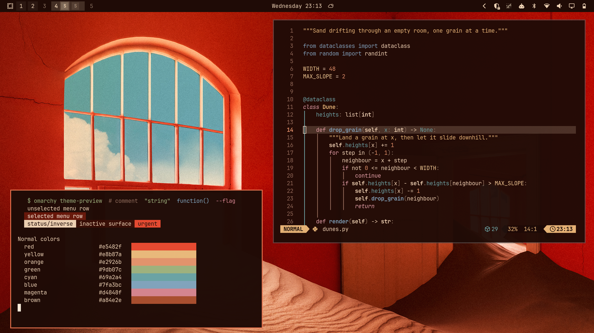

# The Slow Rush

An [Omarchy](https://omarchy.org) theme inspired by the cover of Tame Impala's album *The Slow Rush*: red walls, drifting sand and a patch of blue sky.



## Install

```bash
omarchy theme install https://github.com/eliasib13/omarchy-the-slow-rush-theme
```

## Palette

The colours are sampled from the cover where it has them. It has no green, blue or magenta, so those are muted tones chosen to sit alongside the sampled colours.

| Role | Colour | Role | Colour |
|---|---|---|---|
| Background | `#1f0b06` | Red | `#e5482f` |
| Foreground | `#edd1b3` | Orange | `#e2926b` |
| Accent | `#e2704a` | Yellow | `#e8b87a` |
| Selection | `#66170a` | Green | `#9db07c` |
| Muted | `#8f6a5a` | Cyan | `#69a2a4` |
| Brown | `#a84e2e` | Blue | `#7fa3bc` |
| | | Magenta | `#d4848f` |

The full palette is in [`colors.toml`](colors.toml).

## Credits

This is an unofficial fan work, not affiliated with or endorsed by Tame Impala or their label. The wallpaper is a widescreen version of the album cover, with artwork by Neil Krug. All rights to the artwork remain with its owners.
